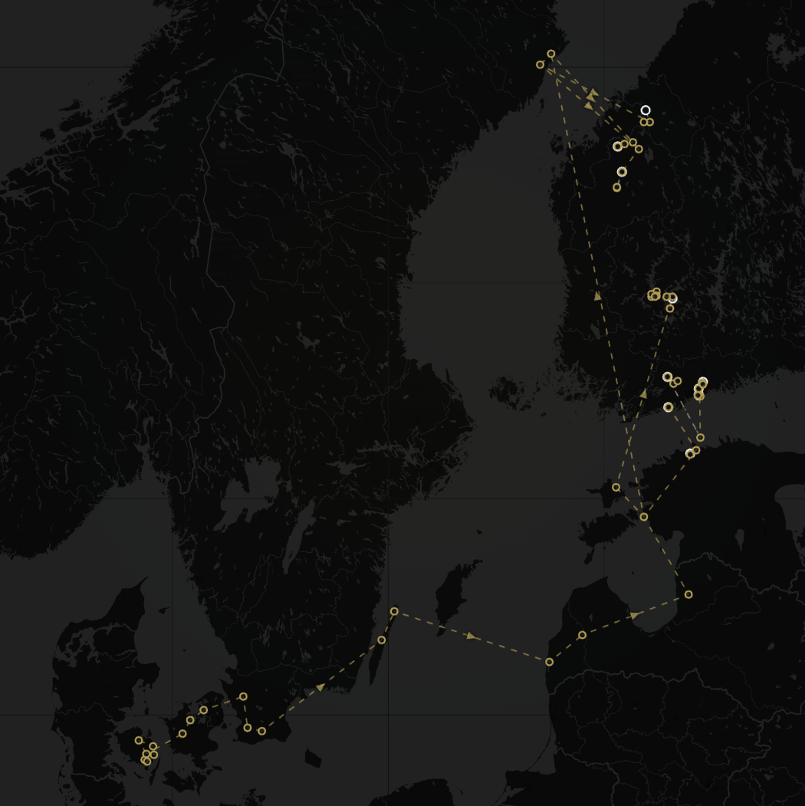
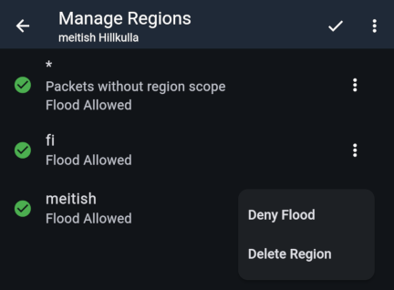

import DocLink from '@components/DocLink.astro';

Region scopes are agreed area codes configured on repeaters to limit unwanted message propagation. The principles in brief:

- Region codes help the network remain usable as it grows. Capacity is limited, so unnecessary packets need to be kept out.
- **Add at least the `fi` region to your repeater** and make sure it is set to `Flood allowed`. **Adding a region code does not block any traffic.**
- Do not block unscoped (`*`) packets unless you understand the effects.
- Find out whether your area uses other region codes and add them as needed.
- At the boundary between two areas, consider whether your repeater could help the other area too. An especially clear example is the southern coast, where some repeaters add the `ee` region to support Estonia. Avoid adding it to too many repeaters, since every message consumes airtime. Keep watching the situation: if the neighbouring network grows strong enough that your repeater is no longer needed, remove its region code.
- On a MeshCore companion device, consider using `fi` or a smaller scope on some channels, or even as the default. Read more in <DocLink page="users/regions">the companion radio region scope guide</DocLink>.

## Background

LoRa communication travels long distances, and national borders do not stop messages. Normally, signals travel directly between antennas, without the upper-atmospheric reflections or other indirect propagation found at lower frequencies. Occasionally, atmospheric conditions allow messages to travel particularly far. This is called _tropospheric ducting_, often shortened to “tropo”. The screenshot shows one packet's Baltic Sea cruise under such conditions.

For MeshCore users, this means adverts from repeaters abroad can reach Finland, adding many new entries to the heard repeater list. Public fills with foreign-language messages, while frequent wardriving transmissions from MeshMapper users mapping networks abroad reach Finland too.

This can be fascinating for an enthusiast, but it has drawbacks. For repeater operators, the most serious is that messages consume their repeaters' permitted airtime, subject to the European 10% _duty cycle_, and battery power. For ordinary users, crowded channels and repeater lists can also be annoying.

As Finland's network grows and separate mesh fragments connect, these currently international problems will arise domestically too. There is no need to forward a local Turku conversation in Pirkanmaa or the Helsinki metropolitan area. The network is not congested yet, so few regional or city scopes have been agreed, but that is changing. Many countries, including Sweden, already use hierarchies of national, regional and municipal scopes.

**From a preparedness perspective**, this is harmful. In a crisis, mesh traffic can be expected to increase everywhere. Local communication being crowded out by foreign traffic would undermine the mesh precisely when it is needed most.

## How MeshCore region scopes work

MeshCore repeater version 1.10 addressed these problems in November 2025. The feature is now mature and widely used.

Repeater settings contain a list of scopes to forward. The first entry has an asterisk (`*`) and the description `Packets without region scope`. User-defined regions follow it.

:::caution[A common misunderstanding]
**The asterisk entry `*` is not a wildcard!** As its description says, it means packets without a region scope. At the protocol level, these differ from scoped packets: they are a kind of legacy packet. MeshCore scopes do not support wildcards. Each region to forward must be named explicitly. You also cannot block a single region and allow every other one. **There is a lot of misunderstanding and incorrect information about this online.**
:::

Messages spreading unnecessarily far are almost always unscoped packets. Using a national scope, `fi` in Finland, addresses the problem at its source. At the receiving end, a repeater owner can also block the forwarding of unscoped packets. **Forwarding is allowed by default, and we do not currently recommend blocking it.**

Each configured scope has a forwarding setting (Flood allowed). The repeater shown has the **fi** scope, as recommended by Finland's MeshCore community. It forwards messages that **users send with the fi scope**. Companion radio users in Finland are instructed to use fi by default. The local scope **meitish** is also enabled: in this mesh, announcements about local events use an agreed local scope.

The pictured repeater also forwards unscoped packets: 'Flood allowed' is enabled for the asterisk entry. 'Deny flood' blocks them.

:::tip[Technically...]{icon="seti:json"}
...a scoped message is hashed using the scope name. Every configured region adds one more hash comparison for each flood message. These run in configuration order, so ordering has a small effect on performance.
:::
