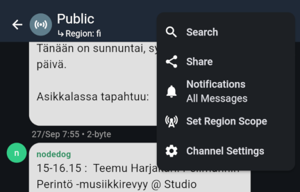
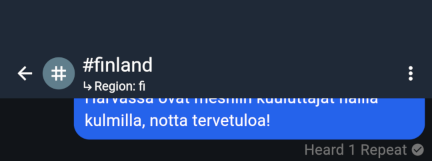
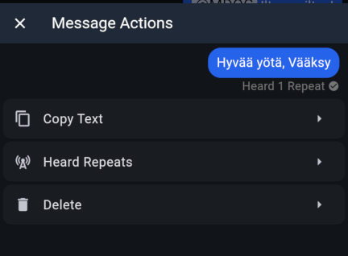
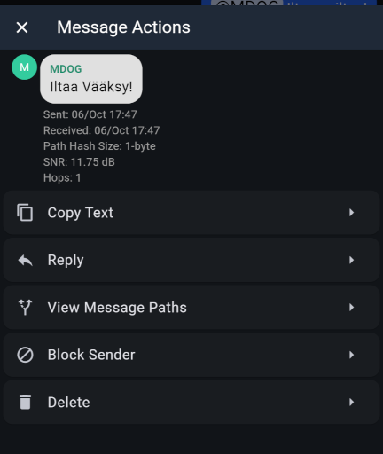

import DocLink from '@components/DocLink.astro';

MeshCore channels are for conversations between multiple users. Your companion radio transmits a channel message, and it is forwarded as far as the repeater network allows. Its reach is limited only by the **region scope**, covered on the previous page, and the **Path Hash Size**, which Finland's MeshCore network sets to two bytes per hop (2-byte). The path record limits each message to a maximum of 32 repeater hops.

The record helps repeaters and companion radios track a message's journey through the mesh. For private messages and certain other transmissions, the repeater path enables MeshCore's key insight: once a message reaches its destination, it contains the route it took. A reply can follow that same route. Only the repeaters already shown to form a reliable chain between sender and recipient take part in forwarding the reply. That **path** remains in use for as long as it works reliably.

:::tip[Technically...]{icon="seti:json"}
...the protocol reserves a fixed amount of space for recording the repeater path. Recording one byte per hop fills it after 64 hops; Finland's MeshCore network records two bytes per hop, so it fills after 32.

The recorded bytes are the **first bytes of each repeater's public key**. With one-byte records, it becomes increasingly likely that multiple repeaters along a route share the same initial byte. Finland therefore requires two-byte records, making such coincidences much less likely.
:::

Channel messages **do not use the repeater path** in the same way as private messages: they are always forwarded throughout the mesh. For one-to-one communication, **private messages are a better choice** for the network. Channel messages also do not guarantee the sender's identity with the same cryptographic assurance as private messages. The sender's name is shown, but it is simply the name included in the message.

When your phone or computer is disconnected from the companion radio, received messages stay in the radio's memory and are retrieved when you reconnect. Memory can be limited, particularly on nRF52 devices, so a device forgotten in a drawer may fill up quickly.

One final lesson about channel messages: once a message has been forwarded through the mesh, the opportunity to receive it has passed. Your companion radio must be **powered on and within range** to receive it. If you leave your local mesh with your companion radio, you miss the channel conversations that happen while you are away. Those messages will not appear retrospectively when you return.

## Public, the original channel

Every companion radio worldwide follows the Public channel. It is MeshCore's most public forum. A message sent to Public appears for every companion radio user within range and as far as the repeater network reaches.

## Open channels, or hashtag channels

Channels whose names start with # are **open channels**. They work like Public: technically, Public and open channels use agreed encryption keys, so every device can decrypt them.

Anyone can “create” an open channel simply by adding it to their companion radio's channel list. When others add a channel with the same name, they can all see its messages. The trick is the leading #, which tells MeshCore to encrypt the channel using the same agreed-key approach as Public.

## Private channels, without a hashtag

When you create a channel without #, the companion radio generates a **unique encryption key**. Only the channel's creator initially knows that key. These messages travel through the mesh just like the others, but the encryption key is not public, so messages cannot be read without it.

To invite other users, share the exact channel name and encryption key. Only people who receive the key can read its messages. Sharing a channel is explained below.

## Using channels in the MeshCore app

Messaging is similar enough to familiar chat apps that we will skip the obvious parts. You can reply to messages and mention users by name so they receive a notification. Message length is limited, and your nickname uses some of that space too. Finnish accented letters take twice the space of ordinary ASCII letters; emojis take even more.

Public is always in the channel list. We will use it to explore **channel settings**, found in the upper-right menu.

- **Search** ▹ Filters the view as you type to show messages containing the search text.
- **Share** ▹ Displays a QR code another user can scan to add the channel. 'Copy Link to Clipboard' in the upper-right corner copies the QR code's content as a link you can share elsewhere.
- **Notifications** ▹ Choose channel notifications, including mentions only or fully muted.
- **Set Region Scope** ▹ Select this channel's region scope. You can also define a new scope here.
- **Channel Settings** ▹ Options for stored message history and blocking users, a list of nicknames seen on the channel, and an action to clear message history.

The most important options are **Share**, the easiest way to give another user access to a private channel, and **Set Region Scope**, useful when your local mesh uses local scopes. For example, repeater operators in Tampere might agree to keep their #tmp-admin channel local and set its scope to **tmp**.

A small **Region: fi** notice below the channel name reminds you of the selected scope. The screenshot also shows **Heard 1 Repeat** under a sent message. Your companion radio is reporting that it heard one repeater retransmit the message. Seeing a repeat gives reasonable confidence that your message is on its way through the mesh. If you hear none, it is fine to try again from a better location. If you hear several, Finland's MeshCore network is doing well 🙃

To try again, long-press or right-click your own message bubble, copy it to the clipboard and paste it into the input field. There are also actions to inspect heard repeats and delete a message from your own device.

Long-pressing or right-clicking a received message opens similar actions. An interesting one is 'View Message Paths', which shows the route a channel message took to your companion radio. It is available only if your phone or computer was connected to the companion radio when the message arrived.

---

The next topic is identity in MeshCore. It lays the groundwork for the final section, where we explore private messages and routing paths.
