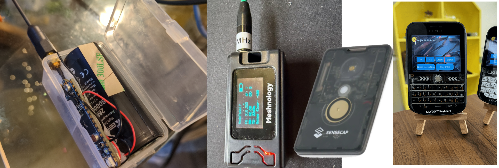
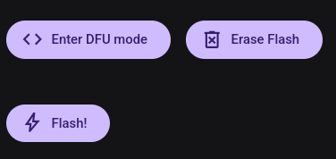
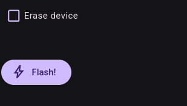
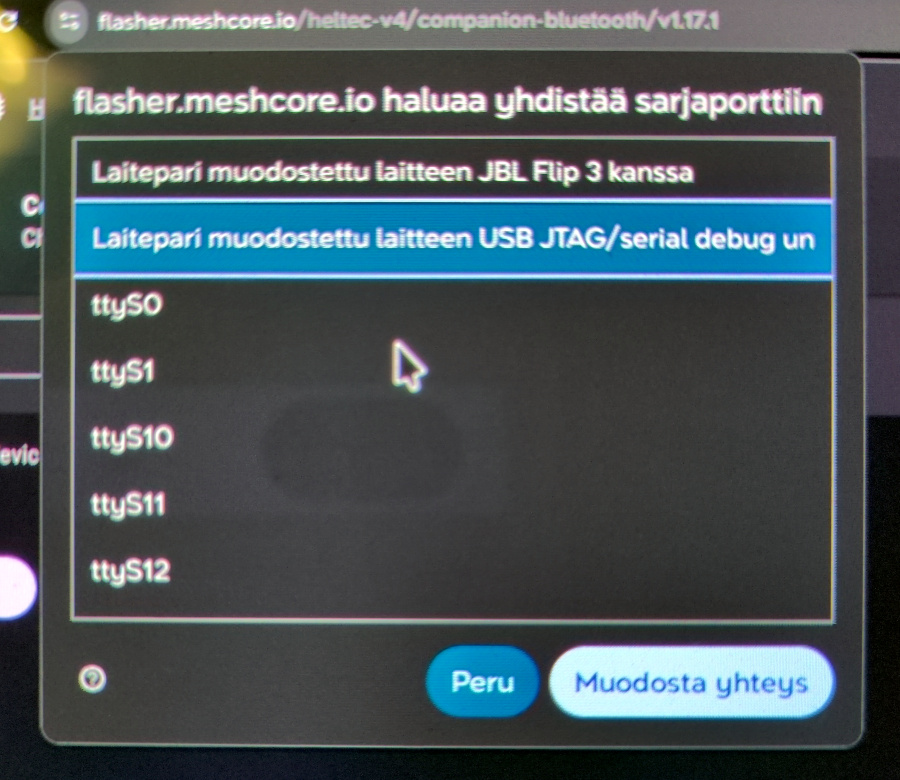

import DocLink from '@components/DocLink.astro';
import { Tabs, TabItem } from '@astrojs/starlight/components';

Your first look at mesh hardware can feel like being dropped into a jungle of options. With this guide, we hope you can choose a useful device that suits you on the first attempt.

It helps to know that **all the options** fall into two camps based on their _System-on-Chip_ (SoC):

| System-on-Chip | Characteristics                         |         Manufacturer         |
| :------------: | :-------------------------------------- | :--------------------------: |
|   **ESP32**    | Versatile, power-hungry, includes WiFi. |   Espressif Systems, China   |
|   **nRF52**    | Simple, power-efficient, no WiFi.       | Nordic Semiconductor, Norway |

Another thing to remember is that no device is a ready-to-use MeshCore companion radio straight out of the shop. You may find a product with MeshCore companion firmware already installed, but rapid development means that version is invariably old. [Flashing](#installing-the-firmware), covered below, is a basic MeshCore skill worth learning right away.

A third complication is that there is no single established term for these devices. Online shops may call them:

- Mesh node
- Mesh radio
- LoRa development board
- Meshtastic device
- Wireless tracker / tag
- Communication device

MeshCore Finland does not recommend particular shops. Devices are not currently sold in Finland, so you will need to buy from an overseas online retailer.

:::tip[Before you buy!]{icon="warning"}
Once you find a device you like, check that MeshCore companion firmware is available for it before ordering. [More on that below](#installing-the-firmware).
:::

## Ready-made or DIY?

Building your own lets you create a personal and very inexpensive companion radio. At its simplest, you need a €10–30 development board, a durable enclosure and a USB power bank. Practically all products of this kind can also be connected to a lithium battery without extra purchases: a cable and connector are included, and the devices have built-in charging circuitry.

Ready-made options range from credit-card-sized trackers to devices with a keyboard and screen. These are somewhat more expensive, typically €100–200. The community has made excellent MeshCore applications, particularly for keyboard devices, but you will need to look beyond the official Flasher website to find them.

## Installing the firmware

:::note
If you will use your companion radio with a mobile or desktop app, now is a good time to choose and install one. The MeshCore project's official app is [Liam Cottle's MeshCore](https://meshcore.io/#download).
:::

Officially supported companion devices are listed in [MeshCore Flasher](https://flasher.meshcore.io). If your device is listed, it is officially supported and a dependable choice as a companion radio. Installation runs directly on that website and is largely automatic. You need a computer browser: browser-based installation is not available on mobile devices. Here, _flashing_ means installing the firmware.

:::note[Requirements]

- **Connect an antenna before powering on the device!** Transmitting without an antenna reflects power back into the radio and may damage it.
- Browser installation requires a browser with Web Serial API support (Chrome / Chromium, Edge, Opera and recent Firefox browsers).
- Your USB cable must carry data, not just charging power.
- On Linux, add your user to the group that owns the USB serial port (often _dialout_ or _uucp_) to allow flashing.
- If it will not work, try another cable or a different USB port on your computer.
  :::

Connect the device to your computer with a cable and select its name from the list. In the next list, choose **Companion Bluetooth** or **Companion USB**, depending on whether you want to connect wirelessly over Bluetooth or through a USB cable.

The next page is the final step before installation. You can choose a firmware version; the latest is selected automatically. For **nRF52** devices, the following actions are available. These devices must enter DFU mode before flashing, so first select 'Enter DFU mode'.

The view is simpler for **ESP32** devices. Yours may still require a button combination to enter flashing mode before installation can begin. It is worth trying without that first.

In both cases, start the first installation with a clean slate by using _Erase flash_ / _Erase device_. When updating to a newer version later, do not use this action, as it would erase your settings.

Finally, press _Flash!_. The browser opens a dialog where you select your device. Press the connection button ('Muodosta yhteys' in the Finnish dialog shown below) to begin. **Do not interrupt installation once it has started!** It takes only about ten seconds.

If installation succeeded, congratulations: your companion radio is ready for service! If it failed, try again. With an ESP32 device, a likely reason is that it needs to be put into flashing mode. The device's instructions or the MeshCore Finland discussion group should help.

---

## Next, configure the settings

Setup continues with configuration. There are many devices and apps; these pages walk you through the settings using the official MeshCore app. If you use another device or app, you will need to adapt the instructions.
