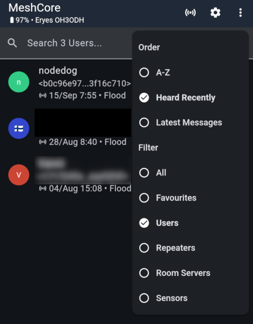
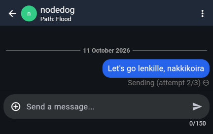
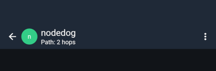
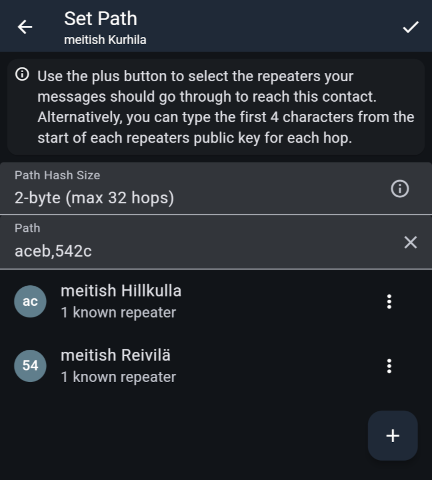

import DocLink from '@components/DocLink.astro';

_Path routing_ is MeshCore's standout feature. For everyday users, it is especially visible in private messaging.

In the previous section, we learned that private messaging requires sharing public keys. This adds someone to your contact list so you can exchange messages. Here is what happens when you send a private message to someone you have not messaged before:

To make the contact list easier to browse, filter it to show only _Users_. We are about to message _nodedog_. The list shows that the message will be sent as a mesh-wide _flood_, since we do not yet know a path to _nodedog_. Select the user and write a message...

Once sent, the message is encrypted using _nodedog's_ public key. MeshCore transmits it for the whole local mesh to forward, then waits briefly for an **acknowledgement** (_ack_). If none arrives, it retries twice.

If _nodedog_ and their companion radio are out of range of the mesh, delivery is marked as failed. You can retry with a long press or right-click. Successful delivery is detected when the acknowledgement from _nodedog's_ companion radio arrives.

This is where MeshCore's path routing comes in. The acknowledgement contains information about which repeaters successfully delivered the message to _nodedog's_ companion radio. Traffic becomes path-routed when _nodedog_ sends a reply: the successful path is reversed and the reply follows it. The app now shows that a path has been found, and further messages use it.

Unlike channel messages, path-routed messages do not burden the whole mesh. They may also travel faster if local repeaters are configured that way. Path routing also bypasses region scopes: private messages work independently of them.

## You can set a path manually

If you know your local mesh well enough to identify a suitable route to the recipient, you can set a path in advance or edit it later. The '_Set Path_' action is in the upper-right menu of the message window and in the menu at the end of a contact's row. With a manually configured path, the first message does not need a _flood_ transmission.

Test a path in advance with '_Trace Path_'. It sends a test packet from repeater to repeater along your chosen route. The _Tools_ menu, opened from the upper-right menu of the app's main view, offers two tools: '_Manual_' works like the path editor above, while '_Using Map_' lets you build a route on a map. The map option requires your companion radio's coordinates to be known.

Remember to specify the entire outward and return path. '_Add Return Path_' in the upper-right menu adds the reverse route for you. When the test finishes, its summary shows the signal strength at every hop. Since path testing is itself path-routed, it bypasses region scopes too.

## Paths can stop working when your companion radio moves

A path that works from home may no longer work elsewhere. This is easy to forget with a portable companion radio. If a private message can no longer be sent along a known route, the companion radio eventually sends it as a _flood_ and starts discovering a path again. When you return home, that new route may in turn be invalid, requiring another mesh-wide discovery. This is why manual path configuration is a useful skill.

If you use MeshCore actively, one sensible approach is to install one companion radio permanently at home, where its learned routes remain useful, and carry another when out and about. For a DIY enthusiast, this luxury need not cost much.

---

That concludes the MeshCore Finland user guide. Congratulations: you have earned your **mesh mastery**!

The guide continues with topics for advanced users and developers, before moving on to expanding MeshCore in Finland. Anyone can help grow the network!
