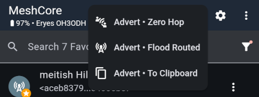
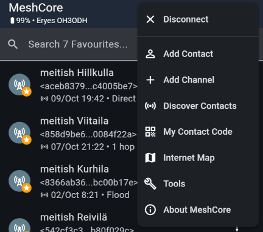
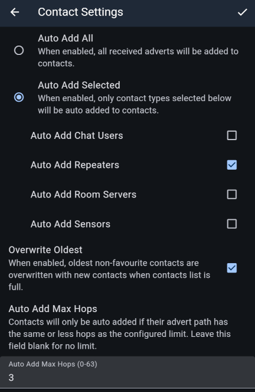

import DocLink from '@components/DocLink.astro';

When you begin your MeshCore journey with a fresh companion radio, you are completely unknown to the mesh and its users. If you only read channel conversations, nobody knows you are there.

In principle, you could also join conversations under a made-up name, because channel messages identify their author only through a nickname: a text string included in the message. Although the official app does not allow it, using a false name on channels is easy. Keep this in mind: even on private channels, a nickname is no guarantee of identity.

In MeshCore, your identity is tied to a _key pair_ stored on your companion radio: a private key and a public key. Their mathematically provable relationship allows someone to send you a message encrypted using your public key that can only be decrypted with the corresponding private key. The keys are created when you install the companion firmware. They also survive firmware updates, provided you do not erase the entire device.

## Sending an advert shares your identity

Private messages in MeshCore are encrypted. Sending one always requires the recipient's complete public key. To send someone a private message, you need to obtain their key somehow, and the same applies in reverse. Distributing the key is called _advertising_.

MeshCore's developers understand the importance of digital identity, as the fine-grained advertising options show. Perhaps you do not want just anyone to message you. In that case, share your key only with people you choose. You can still take part in channel conversations as usual.

Use the icon in the top bar to advertise your public key:

The options are:

- _Advert - Zero Hop_ – send an advert only within your companion radio's range. You could use this to share your key with people present, although it may also reach the rest of your apartment building.
- _Advert - Flood Routed_ – send your advert to all companion radios reachable through the mesh in one go. You certainly will not be unknown afterward!
- _Advert - To Clipboard_ – create a link containing the advert and copy it to the clipboard, ready to share however you like with your chosen audience.

Another way to share your public key is _My Contact Code_ in the upper-right menu. It displays a QR code that gives your key to anyone who scans it.

All these methods lead to the same result: your **actual identity** is added to the recipient's companion radio, and you appear in their **contact list** in the app. You can then exchange encrypted private messages.

## The contact list has limited space

The contact list is stored in the companion radio, where space is limited. By default, it saves every repeater and companion advert it hears. You can, and should, adapt this behaviour on the _Contact Settings_ page.

Choose which contact types to add automatically (_Auto Add Selected_), and limit additions by the number of repeater hops (_Auto Add Max Hops_).

If you prefer to curate your contact list manually, use the list of recently heard adverts (_Discover Contacts_ in the upper-right menu). You can also collect contacts when meeting people using the sharing methods above.

## Backing up and transferring your identity

It is worth backing up your MeshCore identity, the private/public key pair, somewhere outside your companion radio: things happen. In practice, you only need to save the private key, since the public key can be mathematically derived from it. You can then restore your identity to a new companion radio if needed. The option is on the _Manage Identity Key_ settings page.

Settings also include _Export_ / _Import Config_. These let you save not only the private key but also your contact list and all app and companion radio settings, so a new companion radio can be set up just like the old one.

---

Your identity comes into its own with private messages. These also introduce MeshCore's most useful feature: **paths**. More on those in the next section.
