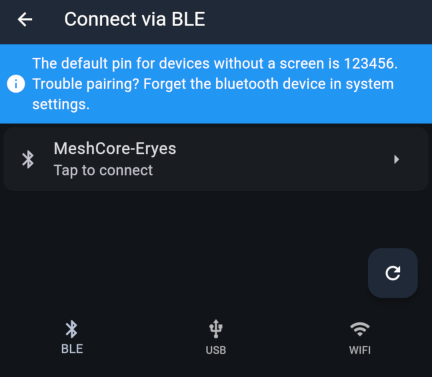
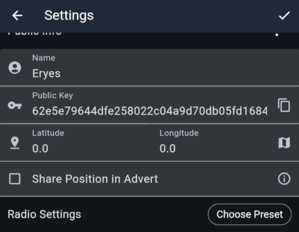
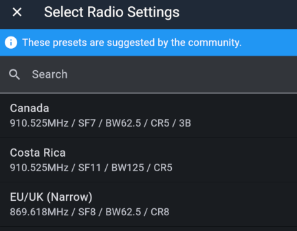
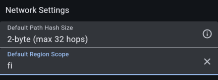
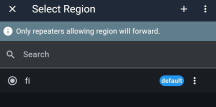

import DocLink from '@components/DocLink.astro';

## Finnish MeshCore settings

These are the most important settings. Set them as shown so your messages travel through Finland's MeshCore network.

| Setting                |    Value     | Meaning                                                                                  |
| :--------------------- | :----------: | :--------------------------------------------------------------------------------------- |
| Radio Preset           | EU/UK Narrow | Sets the basic radio parameters: frequency and LoRa modulation.                          |
| Default Path Hash Size |    2-byte    | Records two bytes per repeater hop to reduce the risk of ambiguity.                      |
| Default Region Scope   |      fi      | Sends all messages with Finland's national region scope unless overridden for a channel. |

## Configuration step by step

These instructions use the [official MeshCore app](https://meshcore.io/#download). It works the same way on mobile devices and computers.

- Connect to your companion radio using the Connect button. The bottom bar lets you choose Bluetooth, USB cable or WiFi. If your device has a screen, it displays the Bluetooth pairing code; otherwise, the default code is 123456.

- Once connected, open the companion radio's settings using the gear icon that appears where the Connect button was.

- Give your companion radio a name. This is the name others see in channel conversations and private messages. The public key is the address used to route traffic. You do not need to edit it; this guide explains its use later.

- You can set the device's location using coordinates, for example if your companion radio will be permanently installed at home. With a known location, the app can show distances to repeaters and other users. Devices with GPS can determine their location automatically; enable this on the 'Position Settings' page. To share your location publicly, check 'Share Position in Advert'.

- The MeshCore app provides a preset containing the radio settings. Press 'Choose Preset' and select 'EU/UK (Narrow)'. Avoid changing these parameters, as your messages would then fail to travel through Finland's MeshCore network. The same radio settings are used by MeshCore throughout Europe.

- The remaining important settings are further down. Select 'Default Path Hash Size' → '2-byte'. Open 'Default Region Scope', use the + button to add a value, enter 'fi' and confirm. Then select 'fi' in the list as shown and choose 'Set Default' from the menu at the end of its row.

---

---

👍👍 All done! With these settings, you are ready to communicate on Finland's MeshCore network. The following sections cover the skills you will need, so stick around a little longer 😊
