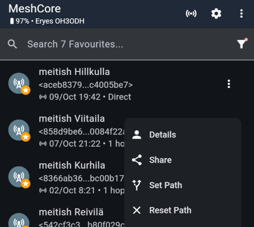

import DocLink from '@components/DocLink.astro';
import { Tabs, TabItem } from '@astrojs/starlight/components';

Suomessa MeshCoressa käytettävät asetukset on pitkälti vakioitu. Tältä sivulta löydät näppärän rimpsun, jonka kopiointi, kevyt muokkaus ja liittäminen toistimen komentoriville määrittää asetukset kerralla. Ohjeistettuna on myös asetusten teko käyttöliittymän kautta, mutta tällä tavalla kaikkia asetuksia ei voida määrittää. Komentorivin kautta komentaminen on näin ollen suositeltava tapa.

Komentoriviin pääset käsiksi
* Selaimessa MeshCore Flasherin etusivulta löytyvällä Repeater Setup -työkalulla, kun toistin on kytkettynä tietokoneeseen USB-kaapelilla
* Virallisen sovelluksen kautta myös radioteitse, joko meshin yli tai suoralla yhteydellä
* Tietokoneella käyttämällä meshcore-cli-ohjelmistoa.

## Muokkausta ja pohdintaa seuraaviin

Nämä voi määritellä sekä käyttöliittymässä että komentorivillä:
* Toistimelle pitää antaa **nimi**. Useimmiten nimi viittaa paikkaan, jonne toistin päätyy työtään tekemään. Nimen suhteen sinulla on vapaat kädet, mutta pidä järki päässä ja käytöstavat mielessä.
* Toistimen **sijainti** annetaan koordinaatteina.
* **Mainostuksen toistotiheys** eli Advert Interval asetetaan erikseen koko meshin alueelle välitettäviin mainoksiin (yksikkönä tunnit) sekä vain toistimen kantaman kattaviin suoriin mainoksiin (yksikkönä minuutit). Muista, että jokainen mainos on lähete, joka rasittaa akkukäyttöisen toistimen akkua, ja että jokainen flood-mainos rasittaa koko meshiä. [Lue syventävä osuus.](#mainostamisesta-adverts)
* Toistetaanko viestit, joissa **ei ole aluerajausta**, tai rajoitetaanko niitä? Suomen MeshCoressa pyritään siihen, että kotimainen viestintä käyttää fi-aluerajausta. Näin maan ulkopuolelta aika ajoin saapuvat viestit voidaan erottaa meille tärkeimmästä paikallisesta viestinnästä. Viestit ulkomailta välitetään kaikille alueesi meshin käyttäjille, jos ne sallitaan, ja tämä saattaa paikoin ärsyttää. Lisäksi ne kuluttavat toistinverkon radioaikaa ja akkuja. <DocLink page="repeaters/regions">Lue syventävä osuus.</DocLink>
* Toistettavat regionit: **fi** joka tapauksessa. **offgrid**, jos toistin on sähköverkosta riippumaton. Lisäksi paikallisesti sovitut [pienemmät aluerajaukset](#paikalliset-aluekoodit-rajaukset). Jos toistin on paikalla, jossa se voi olla naapurimaan MeshCoren apuna (rannikot ja rajaseudut), voidaan lisätä myös naapurimaan kansallinen aluerajaus ja tehdä naapuriapua.
* Lähetyksen teho (**set tx / Transmit Power (dBm)**) täytyy asettaa oman laitteiston speksin mukaan: 21 / 22 / 23. Huomattavaa on, että 23 dBm saattaa **ylittää sallitun lähtötehon** suuntaavia antenneja käytettäessä.

## Yleisimmät asetukset Suomessa

<Tabs syncKey="interface">
  <TabItem label="Komentorivikomennot">

Harmaalla taustalla olevat asetukset on selitetty alla.

```txt {15-17,19} /[[].*\]/ "22"
set name [nimi]
set lat [leveysaste]
set lon [pituusaste]

set radio 869.618,62.5,8,8
set tx 22
set dutycycle 10

set path.hash.mode 1
set advert.interval 0
set flood.advert.interval 47
set loop.detect moderate

region put fi
# region put oma_lähialue
# region put naapuri_region
# region put offgrid
region put eu
# region default fi
region save

clock sync
```

  </TabItem>
  <TabItem label="Käyttöliittymällä">

| Asetus | Arvo |
|:-------|:----:|
| *Name & Location ...* | |
| ` > `  Name | (nimi) |
| ` > `  Latitude | (koordinaatti) |
| ` > `  Longitude | (koordinaatti) |
| *Access ...* | |
| ` > `  Admin password | (hallinnan salasana) |
| *Radio settings ...* | |
| ` > `  Preset | EU/UK (Narrow) |
| ` > `  Duty Cycle (%) | 10 |
| *Advertising ...* | |
| ` > `  Advert interval (minutes) | 0 |
| ` > `  Flood advert interval (hours) | 47 |
| *Regions ...* | |
| ` > `  Default region | fi |
| ` > `  Home region | fi |
| ` > `  Unscoped traffic → Allow Flood | ☑ / ☐ |
| ... + Add region | |
| ` > `  Region name | fi |
| ` > `  fi → Allow Flood | ☑ |
| ... lisää muut alueet samoin | |
| *Advanced Settings ...* | |
| ` > `  Repeat | ☑ |

  </TabItem>
</Tabs>

* **Nimi on pakollinen, max 23 *tavua***, pidä mielessä, kun käytät ääkkösiä tai emojeja, ne vievät useamman tavun (UTF-8).
* Sijainti annetaan **desimaaliasteina** eli esimerkiksi lat `60.172` lon `24.941`. Toistimen sijaintia ei tarvitse laittaa *täsmälleen* siihen, missä se sijaitsee, mutta pidä sijainti 100 m sisällä, jos mahdollista. Jos et halua toistinta kartalle, älä aseta sijaintia tai aseta molemmat arvoon `0`.
* Lähetysteho voi olla `22` dBm, jos antennin maksimivahvistus (gain) on korkeintaan 5 dBi. Korkeammilla vahvistuksilla tehoa on laskettava.
* Regioneihin lisätään:
  *  `fi`, joka on koko Suomen kattava aluekoodi
  *  mahdolliset oman alueen aluekoodit, näitä ei ole vielä juurikaan käytössä, mutta pyritään sopimaan alueellisesti
  * jos olet alueiden rajalla, voi tulla kyseeseen lisätä useamman alueen koodeja
  * `offgrid`-aluekoodin voi lisätä toistimiin, jotka toimivat ilman jatkuvaa verkkovirtaa eli niissä on joko sisäiset akut tai ulkoinen akkuvarmistus (UPS). Tämä asetetaan, jotta offgrid-meshin suorituskykyä voidaan tarvittaessa testata.
* Default region -asetus (`set region default`) määrittää vain sen, millä toistimen omat mainostukset (advert) lähetetään. Se ei vaikuta millään tavalla toistettavaan liikenteeseen. Etelä-Suomessa suosittelemme asettamaan sen `fi`-alueeksi, muualla sitä ei tällä hetkellä (lokakuu 2026) tarvitse asettaa.
* **Regioneiden osalta tärkeintä tässä vaiheessa on, että `fi` on lisättynä**. Lisää aiheesta <DocLink page="repeaters/regions">Aluerajaukset toistimissa</DocLink> -sivulta.

## Mainostamisesta (adverts)

Toistimet mainostavat olemassaoloaan tietyin väliajoin. Mainostuksia on kahta eri tyyppiä ja molemmat voi myös laittaa pois päältä:
* **Zero-hop advert**, joka leviää naapuritoistimille ja suoraan kuulolla oleville kumppaneille 0-240 minuutin välein. Sitä ei toisteta eteenpäin. Tämä rasittaa vain paikallista radioaikaa sen yhden advert-paketin verran. Kulkuneuvon mukana liikkuvan toistimen tapauksessa suorat mainokset saattavat olla käyttökelpoinen vaihtoehto.
* **Flood advert**, joka leviää niin pitkälle kuin meshi (aluekoodit huomioon ottaen) yltää. Niitä lähetetään 3-168 tunnin välein (oletusarvo 47 h), ellei niitä ole poistettu käytöstä. Flood advertit näin ollen kuluttavat merkittävästi radioaikaa meshissä. Monissa verkoissa mainostukset muodostavatkin valtaosan meshin liikenteestä ja siksi niitä halutaan suitsia.

:::note[Miksi toistimet mainostavat?]
Toistimen mainostusviestejä **ei tarvita mihinkään itse verkon toimivuuden kannalta**. Verkko toimii yhtä hyvin tai huonosti riippumatta siitä, mainostaako yksikään toistin itseään vai ei. Ne ovat olemassa vain verkon toiminnan seurantaa ja erilaisia karttapalveluita varten.
:::

Toisaalta koska keräämme verkosta jatkuvasti tietoa ns. observereilla, niin mainostukset ovat erinomainen tapa nähdä, mikä on tietyn toistimen kuuluvuus. Lisäksi toistimen päätyminen MeshMapper, CoreScope yms. kartoille vaatii, että sijainnin sisältävä mainostus on kuultu observer-verkostossa. Lisäksi alueella, jolla ei ennestään ole MeshCore-käyttäjiä, pieni mainostaminen radioaalloilla ei ole pahitteeksi, jos joku muu sattuu kokeilemaan kumppanilaitetta.

Jos haluat käyttää mainoksia toistimen elonmerkkeinä itsellesi, yksi hyvä ratkaisu on määritellä mainosväliksi jotain väliltä 49 - 71 tuntia. Tällöin mainokset lähtevät aina eri vuorokaudenaikoina – mainostat myös niille, jotka olisivat tasavuorokautisen mainosaikasi aikaan muualla. Oma sovelluksesi näyttää viimeisimmän kuullun mainoksen ajankohdan; jos viimeisimmästä mainoksesta on yli kolme päivää, saattaa olla että jokin on vialla. Jos siitä on yli kuusi päivää, on syytä tarkastaa toistimen tilanne.

## Paikalliset aluekoodit (rajaukset)

Paikallisesti voidaan sopia esimerkiksi, että perustetaan oma avoin kanava (``#tmp-admin``) toistinten ylläpitäjien viestintään, ja käytetään kanavalla oletusrajauksena paikallista aluerajausta (``tmp``). Näin viestit eivät turhan tähden rasita koko fi-aluetta. Samaa periaatetta voi soveltaa myös muuhun paikalliseen viestintään.

Lisää aiheesta <DocLink page="repeaters/regions">Aluerajaukset toistimissa</DocLink> -sivulta.

## Mikä ihmeen `path.hash.mode`?

Jokaisella toistimella on uniikki julkinen avain, joka on 64 tavua (128 heksamerkkiä) pitkä. Se tunnetaan myös toistimen identiteettinä tai ID:nä. Kun toistin mainostaa itseään, se pistää tästä ID:stä 1, 2 tai 3 ensimmäistä tavua paketin polkuun ja lähettää sen ulos. Mikäli kyseessä on *flood advert*, muut toistimet lisäävät oman ID:nsä tähän polkuun myös samalla pituudella (1-3 tavua) kuin alkuperäinen lähettäjä.

Kartoissa ja analyysityökaluissa 1 tavun polut aiheuttavat suurta päänvaivaa, koska sillä on vain 254 mahdollista arvoa (`00` ja `FF` ovat kiellettyjä) eli on väistämätöntä, että maailmalla, Suomessa ja jossain kohtaa samassa kylässäkin on kaksi toistinta, jotka sattuvat omaamaan saman ensimmäisen tavun. Tällöin reittien arviointi ja esim. kuuluvuuskarttojen tekeminen menee hankalaksi, kun toistimen ID ei ole yksiselitteinen.

`path.hash.mode`-asetus määrittää tämän käytetyn ID:n pituuden. Se on historiallisista syistä edelleen vakiona 1 tavu (asetus `0`), mutta suosittelemme *erittäin vahvasti*, että käytetään 2 tavun (4 heksan) ID:tä, jolloin asetus on `1`. Tämä sallii jo yli 64 tuhatta eri uniikkia prefixiä. Toistimen omistaja voi myös halutessaan laittaa suoraan asetukseksi `2`, jolloin ID on kolmitavuinen (6 heksaa).

## Toistimen etähallinnasta meshin yli

Asennuspaikalla olevan toistimen asetusten hallinnointi onnistuu meshin yli, mutta varminta ja meshin kannalta säästeliäintä on hakeutua radiokantaman päähän laitteesta ja komentaa sitä suoralla yhteydellä.

Toistimen hallinta aloitetaan valitsemalla toistin kontaktilistalta ja painamalla *Manage*-hammasrataskuvaketta. Kirjautuminen tapahtuu salasanalla.

Meshin yli toimiessa fiksuinta on määritellä aluksi **polku** jota pitkin paketit kulkevat edestakaisesti. Jos et määrittele polkua käsin, kirjautumisviestisi kulkeutuu koko meshiin ennen kuin kumppaniradio saa vastauksen ja ottaa käyttöön vastauspolun.

Polku määritellään alla esitellyssä näkymässä. + -painikkeella lisätään toistimia polkuun. Voit myös itse kirjoittaa kenttään julkisen avaimen ensimmäiset tavuparit pilkuilla eroteltuna. Polku määritetään vain 'menosuuntaan'.




Lähietäisyydelle hakeutuminen hallinnointia varten paljastaa virallisen sovelluksen puutteen: yhteydenmuodostus lähettää väkisin floodattavan paketin, mutta kun toistimen vastaus tulee suorana, toiminta muuttuu suoraksi (polun kohdalla lukee *Direct*.) Tällöin voit olla varma, ettei asetusten työstö aiheuta ylimääräistä kuormaa meshille.
